# INFORME DE IMPLEMENTACIÓN DE UNA ARQUITECTURA MONOLÍTICA CON NODE.JS, POSTGRESQL Y PRUEBAS AUTOMATIZADAS

---

## 1. TÍTULO

**Implementación y validación de una aplicación monolítica utilizando Node.js, Express, PostgreSQL, pruebas automatizadas y control de versiones con Git**

---

## 2. INTRODUCCIÓN

En el desarrollo de aplicaciones de software existen diferentes estilos arquitectónicos que permiten organizar los componentes de un sistema y establecer la forma en que estos interactúan. Uno de estos estilos es la **arquitectura monolítica**, en la cual las funcionalidades principales de una aplicación se encuentran integradas dentro de una misma unidad de ejecución.

El presente proyecto tiene como finalidad implementar una aplicación web bajo un enfoque monolítico utilizando tecnologías orientadas al desarrollo de aplicaciones modernas. Para ello, se emplearon **Node.js** y **Express** para la construcción de la API, **PostgreSQL** como sistema gestor de base de datos, **Jest** y **Supertest** para la ejecución de pruebas automatizadas y **Git** para el control de versiones.

El desarrollo parte de la configuración del entorno de trabajo utilizando **WSL2 / Linux**, **Node.js**, **PostgreSQL** y **Docker**, siguiendo posteriormente la construcción de una aplicación monolítica que administra tres entidades principales: **usuarios**, **productos** y **pedidos**.

La aplicación implementada permite comprobar el funcionamiento de sus componentes mediante diferentes endpoints REST. Además, se desarrolló una prueba de error controlado con el propósito de comprobar que las pruebas automatizadas son capaces de detectar una modificación incorrecta en el código.

Finalmente, el proyecto fue inicializado como repositorio Git y se realizó un primer commit correspondiente a la versión funcional inicial del monolito.

---

## 3. OBJETIVOS

### 3.1. Objetivo general
Implementar y validar una aplicación monolítica utilizando Node.js, Express y PostgreSQL, incorporando pruebas automatizadas y control de versiones mediante Git.

### 3.2. Objetivos específicos
1. Configurar un entorno de desarrollo utilizando WSL2/Linux, Node.js, PostgreSQL y Docker.
2. Crear una aplicación backend utilizando Node.js y Express.
3. Implementar la conexión entre la aplicación y una base de datos PostgreSQL.
4. Diseñar las tablas correspondientes a usuarios, productos y pedidos.
5. Implementar endpoints REST para consultar la información almacenada.
6. Separar la configuración de la aplicación y el servidor mediante archivos independientes.
7. Implementar pruebas automatizadas utilizando Jest y Supertest.
8. Ejecutar una prueba de error controlado para comprobar la capacidad de detección de fallos.
9. Restaurar la aplicación a un estado funcional después de la prueba de error.
10. Registrar la versión funcional del proyecto mediante Git.

---

## 4. MARCO TEÓRICO

### 4.1. Arquitectura monolítica
La arquitectura monolítica organiza las principales funcionalidades de una aplicación dentro de una misma aplicación o unidad de despliegue.

En este proyecto, las funcionalidades relacionadas con usuarios, productos y pedidos se encuentran integradas dentro del mismo backend. Esta estructura permite desarrollar inicialmente el sistema de manera centralizada y facilita la comprensión de las interacciones entre sus diferentes componentes.

El flujo general planteado para el proyecto contempla posteriormente una evolución hacia otras tecnologías y arquitecturas, incluyendo Docker, Git/GitHub, CI/CD, Kubernetes, monitoreo con Prometheus y Grafana y una arquitectura basada en microservicios.

### 4.2. Node.js
Node.js es el entorno utilizado para ejecutar JavaScript en el lado del servidor. En el proyecto permite ejecutar la aplicación backend y gestionar las solicitudes realizadas hacia los diferentes endpoints.

### 4.3. Express
Express es el framework utilizado sobre Node.js para implementar el servidor HTTP y definir las rutas de la aplicación. En el proyecto se utiliza para crear endpoints como:
- `/health`
- `/usuarios`
- `/productos`
- `/pedidos`
- `/db-test`

### 4.4. PostgreSQL
PostgreSQL es el sistema gestor de bases de datos relacional empleado para almacenar la información de la aplicación. La base de datos contiene las tablas:
- `usuarios`
- `productos`
- `pedidos`

La tabla `pedidos` mantiene relaciones con `usuarios` y `productos` mediante claves foráneas.

### 4.5. API REST
La aplicación implementa endpoints HTTP que permiten acceder a los recursos almacenados en PostgreSQL. De esta manera, el backend actúa como intermediario entre las solicitudes realizadas por el cliente y la información almacenada en la base de datos.

### 4.6. Pruebas automatizadas
Las pruebas automatizadas permiten verificar de forma repetible el comportamiento esperado de una aplicación. En este proyecto se utilizaron Jest y Supertest para comprobar que los endpoints principales respondan correctamente.

### 4.7. Jest y Supertest
- **Jest:** Se utilizó como framework para ejecutar las pruebas y verificar las aserciones.
- **Supertest:** Permite realizar solicitudes HTTP directas contra la aplicación sin tener que levantar el servidor manualmente en un puerto de red físico.

La combinación de ambas herramientas permitió validar los endpoints implementados sin necesidad de realizar manualmente cada solicitud con herramientas externas.

### 4.8. Git
Git es el sistema de control de versiones distribuido utilizado para registrar los cambios realizados en el proyecto. Como parte de la implementación se creó un repositorio local y se registró una versión inicial funcional mediante un commit.

---

## 5. ENTORNO DE DESARROLLO

Para la implementación se configuró un entorno basado en Windows con WSL2 y Ubuntu. Las principales herramientas utilizadas fueron:

| Herramienta | Función | Versión utilizada |
| :--- | :--- | :--- |
| **Windows** | Sistema operativo base del equipo anfitrión | Windows 10 Home Single Language (64 bits) |
| **WSL2** | Entorno Linux virtualizado utilizado para el desarrollo | WSL 2 |
| **Ubuntu** | Distribución Linux ejecutada dentro de WSL2 | Ubuntu 24.04 LTS |
| **Node.js** | Entorno de ejecución del backend en Linux | `v22.22.1` |
| **npm** | Gestor de paquetes y dependencias del proyecto | `9.2.0` |
| **Express** | Framework para la API REST | `v5.2.1` |
| **PostgreSQL** | Sistema gestor de base de datos relacional | `v18.6` |
| **Docker** | Plataforma de contenedores (Daemon + CLI integrado en WSL) | `v29.8.0` |
| **Jest** | Framework de pruebas automatizadas | `v30.5.2` |
| **Supertest** | Biblioteca para pruebas de endpoints HTTP | `v7.3.1` |
| **Git** | Sistema de control de versiones distribuido | `v2.53.0` |

Durante la preparación del entorno se validaron los prerrequisitos fundamentales del sistema:

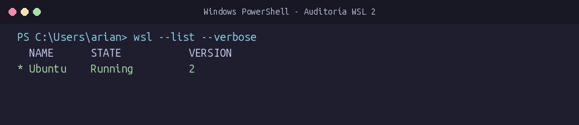
*Figura 1. Verificación del estado activo y la arquitectura WSL 2 de Ubuntu mediante `wsl --list --verbose`.*

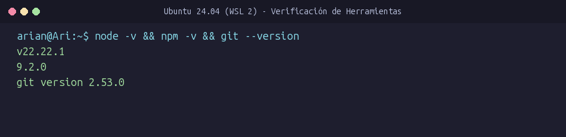
*Figura 2. Verificación de versiones operativas de Node.js (`v22.22.1`), npm (`9.2.0`) y Git (`2.53.0`).*

Asimismo, se comprobó la operatividad de Docker Desktop y su enlace con WSL 2 mediante:
```bash
docker --version
docker run hello-world
```

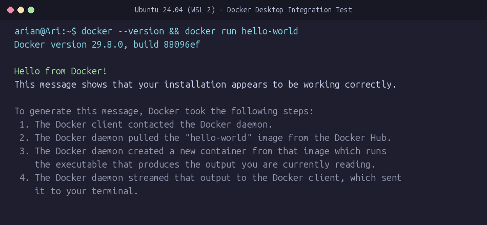
*Figura 3. Descarga y ejecución exitosa del contenedor `hello-world` en el entorno Linux.*

---

## 6. DESARROLLO DEL PROYECTO

### 6.1. Creación del proyecto
Se creó el directorio principal del proyecto en la ruta de usuario de WSL:
```bash
mkdir -p ~/proyecto-monolito-microservicios/monolito ~/proyecto-monolito-microservicios/microservicios
```

La estructura general creada fue:

```text
proyecto-monolito-microservicios/
│
├── monolito/
│   ├── .env
│   ├── .gitignore
│   ├── package.json
│   ├── package-lock.json
│   ├── README.md
│   │
│   ├── src/
│   │   ├── app.js
│   │   ├── db.js
│   │   └── server.js
│   │
│   └── tests/
│       └── app.test.js
│
├── microservicios/
└── evidencias/
```

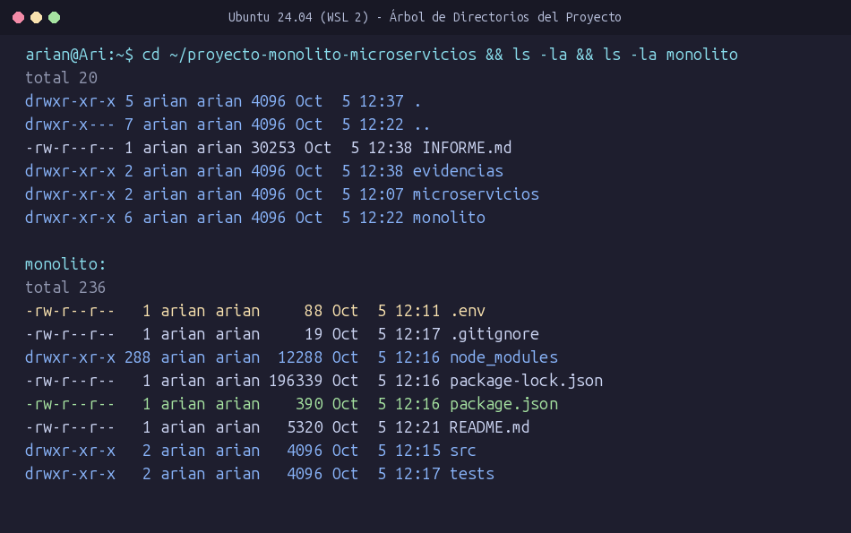
*Figura 4. Visualización de los directorios `monolito/`, `microservicios/` y `evidencias/` mediante `ls -la`.*

Dentro del directorio `monolito/` se ejecutó `npm init -y` para inicializar el proyecto Node.js.

---

## 7. CONFIGURACIÓN DEL BACKEND

Se instalaron las dependencias esenciales de producción:
```bash
npm install express pg dotenv
```

Estas dependencias permiten:
1. **Express:** Construir la infraestructura HTTP del servidor y definir el enrutamiento.
2. **pg:** Establecer la conexión por medio de un pool de clientes relacionales hacia PostgreSQL.
3. **dotenv:** Cargar dinámicamente variables de entorno desde el archivo `.env`.

Inicialmente se implementó en `src/server.js` el endpoint de comprobación:
```http
GET /health
```
con respuesta:
```json
{
  "estado": "ok"
}
```
Se configuró en `package.json` el script `"start": "node src/server.js"` y se verificó la disponibilidad de la aplicación en el puerto `3000`.

---

## 8. CONFIGURACIÓN DE POSTGRESQL

Dentro del entorno PostgreSQL de Ubuntu se creó la base de datos y su usuario administrador:

```sql
CREATE DATABASE proyecto_app;
CREATE USER app_user WITH PASSWORD 'app123';
ALTER DATABASE proyecto_app OWNER TO app_user;
```

Se comprobaron las bases de datos registradas con `\l`, validando que `proyecto_app` estuviera asignada con propiedad a `app_user`.

La configuración de acceso se almacenó en el archivo `.env` en la raíz de `monolito/`:
```env
DB_HOST=localhost
DB_PORT=5432
DB_NAME=proyecto_app
DB_USER=app_user
DB_PASSWORD=app123
```
Esto permite mantener las credenciales completamente aisladas del código fuente.

---

## 9. CONEXIÓN ENTRE NODE.JS Y POSTGRESQL

Se implementó el módulo de conexión en `src/db.js`:

```javascript
require('dotenv').config();
const { Pool } = require('pg');

const pool = new Pool({
  host: process.env.DB_HOST,
  port: process.env.DB_PORT,
  database: process.env.DB_NAME,
  user: process.env.DB_USER,
  password: process.env.DB_PASSWORD
});

module.exports = pool;
```

Para validar la comunicación con la base de datos se desarrolló el endpoint:
```http
GET /db-test
```
El cual ejecuta la consulta `SELECT NOW();` y retorna:
```json
{
  "estado": "ok",
  "mensaje": "Conexión con PostgreSQL correcta",
  "fecha": "2026-10-05T17:15:03.979Z"
}
```
Este endpoint permite diagnosticar de forma inmediata si un fallo corresponde a la aplicación Node.js o a la disponibilidad del motor PostgreSQL.

---

## 10. DISEÑO DE LA BASE DE DATOS

La persistencia del monolito se basa en tres tablas relacionales diseñadas en el esquema público de `proyecto_app`:

### 10.1. Tabla usuarios
```sql
CREATE TABLE usuarios (
 id SERIAL PRIMARY KEY,
 nombre VARCHAR(100) NOT NULL,
 email VARCHAR(150) UNIQUE NOT NULL
);
```

| Campo | Tipo | Restricción |
| :--- | :--- | :--- |
| `id` | `SERIAL` | `PRIMARY KEY` |
| `nombre` | `VARCHAR(100)` | `NOT NULL` |
| `email` | `VARCHAR(150)` | `UNIQUE, NOT NULL` |

### 10.2. Tabla productos
```sql
CREATE TABLE productos (
 id SERIAL PRIMARY KEY,
 nombre VARCHAR(100) NOT NULL,
 precio DECIMAL(10,2) NOT NULL
);
```

| Campo | Tipo | Restricción |
| :--- | :--- | :--- |
| `id` | `SERIAL` | `PRIMARY KEY` |
| `nombre` | `VARCHAR(100)` | `NOT NULL` |
| `precio` | `DECIMAL(10,2)` | `NOT NULL` |

### 10.3. Tabla pedidos
```sql
CREATE TABLE pedidos (
 id SERIAL PRIMARY KEY,
 usuario_id INTEGER REFERENCES usuarios(id),
 producto_id INTEGER REFERENCES productos(id),
 cantidad INTEGER NOT NULL
);
```

| Campo | Tipo | Restricción |
| :--- | :--- | :--- |
| `id` | `SERIAL` | `PRIMARY KEY` |
| `usuario_id` | `INTEGER` | `FOREIGN KEY (usuarios.id)` |
| `producto_id` | `INTEGER` | `FOREIGN KEY (productos.id)` |
| `cantidad` | `INTEGER` | `NOT NULL` |

Se otorgaron los privilegios necesarios al usuario `app_user`:
```sql
GRANT USAGE ON SCHEMA public TO app_user;
GRANT ALL PRIVILEGES ON ALL TABLES IN SCHEMA public TO app_user;
GRANT ALL PRIVILEGES ON ALL SEQUENCES IN SCHEMA public TO app_user;
```

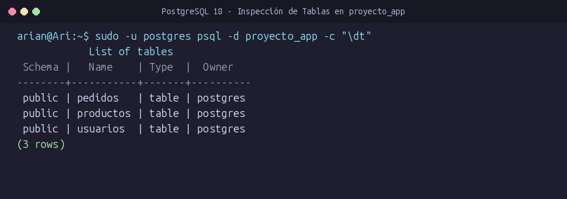
*Figura 5. Lista de tablas relacionales (`usuarios`, `productos`, `pedidos`) inspeccionadas con `psql -c "\dt"`.*

---

## 11. CARGA DE DATOS INICIALES

Se insertaron registros de prueba para validar las consultas y las claves foráneas:

### 11.1. Usuarios
```sql
INSERT INTO usuarios (nombre, email) VALUES
('Ana Torres', 'ana@correo.com'),
('Luis Pérez', 'luis@correo.com'),
('Carlos Mendoza', 'carlos@correo.com');
```

| ID | Nombre | Email |
| :---: | :--- | :--- |
| 1 | Ana Torres | `ana@correo.com` |
| 2 | Luis Pérez | `luis@correo.com` |
| 3 | Carlos Mendoza | `carlos@correo.com` |

### 11.2. Productos
```sql
INSERT INTO productos (nombre, precio) VALUES
('Laptop', 2500.00),
('Teclado', 120.00),
('Mouse', 80.00);
```

| ID | Producto | Precio ($) |
| :---: | :--- | :---: |
| 1 | Laptop | 2500.00 |
| 2 | Teclado | 120.00 |
| 3 | Mouse | 80.00 |

### 11.3. Pedidos
```sql
INSERT INTO pedidos (usuario_id, producto_id, cantidad) VALUES
(1, 1, 1),
(2, 2, 2),
(3, 3, 1);
```

| ID | Usuario asociado | Producto asociado | Cantidad |
| :---: | :--- | :--- | :---: |
| 1 | Ana Torres (ID 1) | Laptop (ID 1) | 1 |
| 2 | Luis Pérez (ID 2) | Teclado (ID 2) | 2 |
| 3 | Carlos Mendoza (ID 3) | Mouse (ID 3) | 1 |

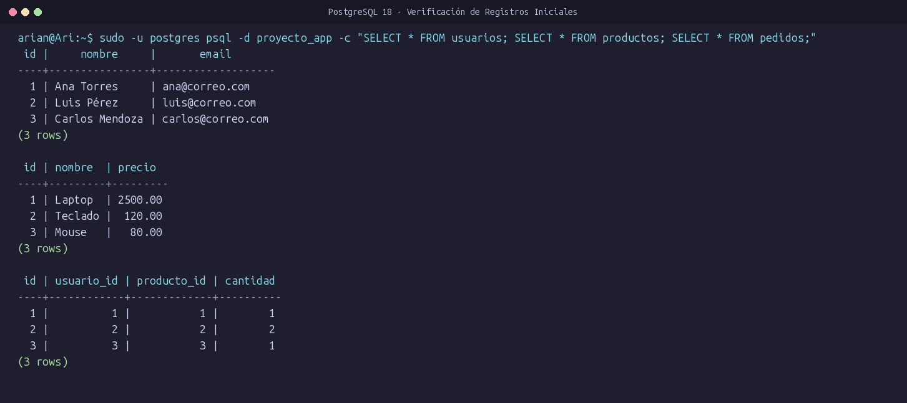
*Figura 6. Validación de registros iniciales en `usuarios`, `productos` y `pedidos` en PostgreSQL.*

---

## 12. IMPLEMENTACIÓN DE ENDPOINTS

Se desarrollaron y verificaron los endpoints principales del sistema:

| Método | Endpoint | Función técnica | Consulta SQL asociada |
| :---: | :--- | :--- | :--- |
| `GET` | `/health` | Verificar disponibilidad del servidor HTTP | N/A (Respuesta en memoria) |
| `GET` | `/db-test` | Comprobar conexión y fecha actual en PostgreSQL | `SELECT NOW();` |
| `GET` | `/usuarios` | Obtener lista de usuarios registrados | `SELECT * FROM usuarios;` |
| `GET` | `/productos` | Obtener catálogo de productos y precios | `SELECT * FROM productos;` |
| `GET` | `/pedidos` | Obtener historial de pedidos | `SELECT * FROM pedidos;` |

Todos los endpoints devuelven respuestas en formato JSON con código de estado HTTP `200` bajo condiciones normales.

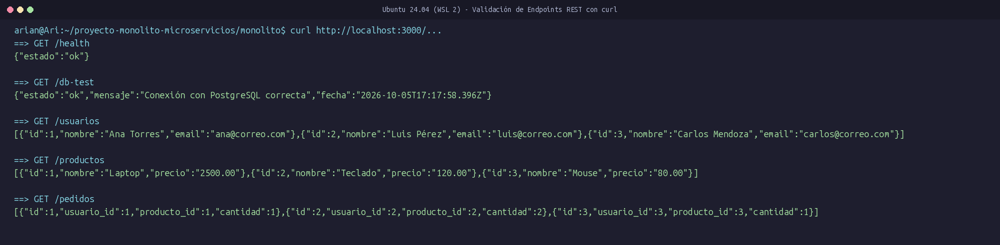
*Figura 7. Salida en consola de peticiones `curl` a `/health`, `/db-test`, `/usuarios`, `/productos` y `/pedidos`.*

---

## 13. ORGANIZACIÓN DE LA APLICACIÓN

Siguiendo el diseño modular recomendado para proyectos sometidos a pruebas unitarias e integrales, se desacopló la definición del servidor en dos archivos independientes:

```text
src/
├── app.js      # Definición de Express, middleware JSON y rutas (exporta app)
├── db.js       # Instancia del Pool de conexiones de PostgreSQL
└── server.js   # Script de arranque: importa app y ejecuta app.listen(3000)
```

- **`app.js`:** Exporta la instancia `app` (`module.exports = app;`) sin activar la escucha por socket de red, lo que permite a Supertest inyectar solicitudes de prueba en memoria sin colisiones de puerto.
- **`server.js`:** Es el punto de entrada para producción o ejecución manual (`npm start`), escuchando activamente peticiones en `http://localhost:3000`.

---

## 14. IMPLEMENTACIÓN DE PRUEBAS AUTOMATIZADAS

Se instalaron las herramientas de testing como dependencias de desarrollo:
```bash
npm install --save-dev jest supertest
```
Se configuró en `package.json`:
```json
"scripts": {
  "test": "jest",
  "start": "node src/server.js"
}
```

Se creó el archivo de pruebas en `tests/app.test.js`:

```javascript
const request = require('supertest');
const app = require('../src/app');
const pool = require('../src/db');

afterAll(async () => {
  await pool.end();
});

test('GET /health debe responder correctamente', async () => {
  const response = await request(app).get('/health');
  expect(response.statusCode).toBe(200);
  expect(response.body.estado).toBe('ok');
});

test('GET /usuarios debe devolver usuarios', async () => {
  const response = await request(app).get('/usuarios');
  expect(response.statusCode).toBe(200);
  expect(response.body.length).toBeGreaterThan(0);
});

test('GET /productos debe devolver productos', async () => {
  const response = await request(app).get('/productos');
  expect(response.statusCode).toBe(200);
  expect(response.body.length).toBeGreaterThan(0);
});

test('GET /pedidos debe devolver pedidos', async () => {
  const response = await request(app).get('/pedidos');
  expect(response.statusCode).toBe(200);
  expect(response.body.length).toBeGreaterThan(0);
});
```

---

## 15. RESULTADOS DE LAS PRUEBAS

Al ejecutar `npm test`, se obtuvieron los siguientes resultados reales:

```text
> monolito@1.0.0 test
> jest

PASS tests/app.test.js
  ✓ GET /health debe responder correctamente (61 ms)
  ✓ GET /usuarios debe devolver usuarios (42 ms)
  ✓ GET /productos debe devolver productos (9 ms)
  ✓ GET /pedidos debe devolver pedidos (8 ms)

Test Suites: 1 passed, 1 total
Tests:       4 passed, 4 total
Snapshots:   0 total
Time:        0.87 s
Ran all test suites.
```

- **Total de pruebas ejecutadas:** 4
- **Total de pruebas aprobadas:** 4 (100% de éxito)
- **Tiempo de ejecución:** < 1 segundo

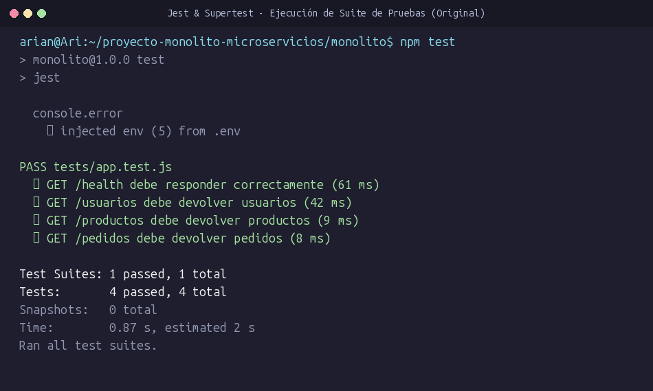
*Figura 8. Ejecución exitosa de Jest y Supertest confirmando 4 pruebas aprobadas.*

---

## 16. PRUEBA DE ERROR CONTROLADO

Para corroborar la capacidad de detección temprana de fallos que brindan las pruebas automatizadas, se ejecutó el Paso Ocho de la guía académica realizando una alteración controlada.

En `src/app.js`, la consulta válida:
```javascript
const result = await pool.query('SELECT * FROM productos');
```
fue reemplazada por un error sintáctico intencional:
```javascript
const result = await pool.query('SELECT * FROM prodctos');
```

Al ejecutar `npm test`, la suite capturó el fallo de inmediato:

```text
FAIL tests/app.test.js
  ✓ GET /health debe responder correctamente (63 ms)
  ✓ GET /usuarios debe devolver usuarios (49 ms)
  ✕ GET /productos debe devolver productos (33 ms)
  ✓ GET /pedidos debe devolver pedidos (23 ms)

  ● GET /productos debe devolver productos

    expect(received).toBe(expected) // Object.is equality

    Expected: 200
    Received: 500

      21 | test('GET /productos debe devolver productos', async () => {
      22 |   const response = await request(app).get('/productos');
    > 23 |   expect(response.statusCode).toBe(200);
         |                               ^
      24 |   expect(response.body.length).toBeGreaterThan(0);
      25 | });

Test Suites: 1 failed, 1 total
Tests:       1 failed, 3 passed, 4 total
```

PostgreSQL reportó:
```text
error: relation "prodctos" does not exist (code: '42P01')
```
Esto causó que el endpoint respondiera con HTTP `500`, lo que activó la aserción de Jest al no coincidir con el código `200` esperado.

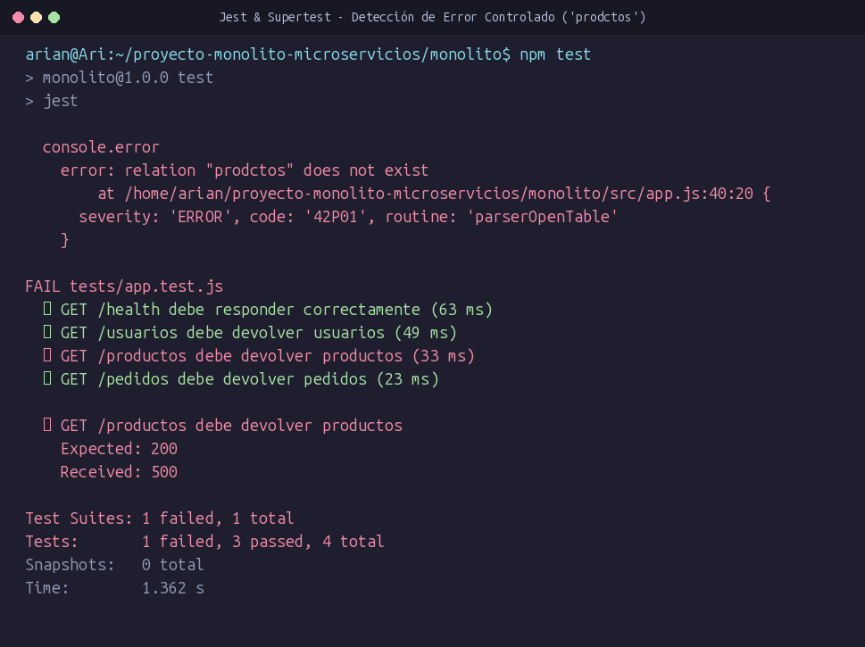
*Figura 9. Jest reportando 1 prueba fallida y 3 aprobadas tras alterar el nombre de tabla a `prodctos`.*

---

## 17. RESTAURACIÓN DEL SISTEMA

Se restauró de inmediato la consulta original en `src/app.js`:
```javascript
const result = await pool.query('SELECT * FROM productos');
```

Se reejecutó `npm test`:

```text
PASS tests/app.test.js
  ✓ GET /health debe responder correctamente (52 ms)
  ✓ GET /usuarios debe devolver usuarios (60 ms)
  ✓ GET /productos debe devolver productos (11 ms)
  ✓ GET /pedidos debe devolver pedidos (12 ms)

Test Suites: 1 passed, 1 total
Tests:       4 passed, 4 total
Snapshots:   0 total
Time:        1.384 s
Ran all test suites.
```
El sistema regresó a un estado **100% funcional y confiable**.

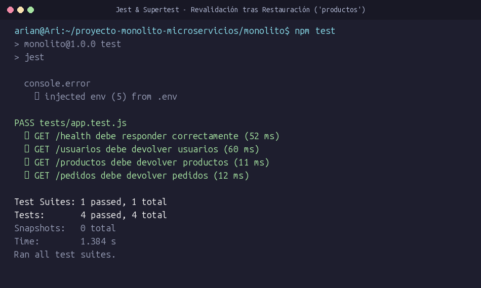
*Figura 10. Reejecución de Jest confirmando el restablecimiento del estado funcional (4/4 PASS).*

---

## 18. CONTROL DE VERSIONES CON GIT

Se configuró el control de versiones en el directorio `monolito/`:

1. **Configuración de `.gitignore`:**
   ```text
   node_modules/
   .env
   ```
   Garantiza que las dependencias voluminosas y las credenciales locales no se incorporen al historial del repositorio.

2. **Inicialización y registro:**
   ```bash
   git init
   git add .
   git commit -m "Version inicial del monolito funcionando"
   ```

3. **Verificación de commit y estado:**
   - **Hash del commit:** `c744c32`
   - **Mensaje:** `"Version inicial del monolito funcionando"`
   - **Comprobación con `git status`:**
     ```text
     On branch master
     nothing to commit, working tree clean
     ```

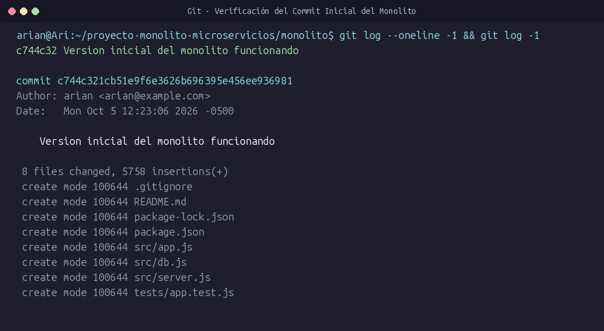
*Figura 11. Registro del commit inicial en Git con `git log --oneline -1`.*

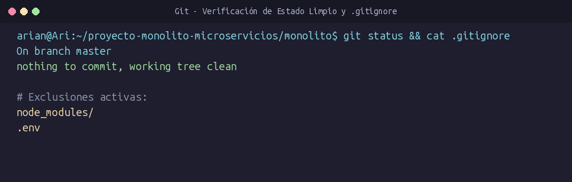
*Figura 12. Comprobación de `git status` limpio y reglas de `.gitignore`.*

---

## 19. ARQUITECTURA IMPLEMENTADA

Diagrama conceptual de la arquitectura monolítica en ejecución:

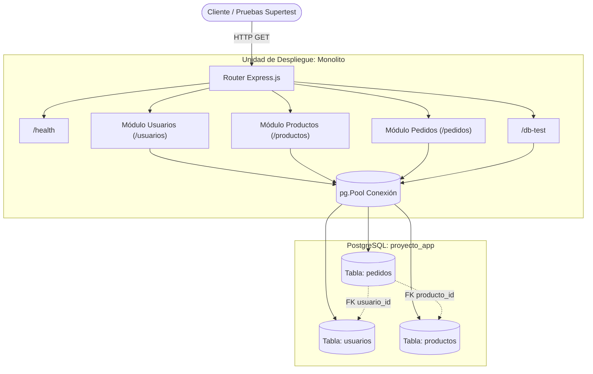

Todos los componentes residen en un mismo proceso de Node.js, constituyendo una arquitectura monolítica clásica que interactúa con un motor de base de datos relacional.

---

## 20. RESULTADOS OBTENIDOS

1. **Servidor HTTP:** Despliegue exitoso de Express en el puerto 3000 con soporte para payload JSON.
2. **Persistencia Relacional:** Conexión robusta a PostgreSQL con pool de conexiones y variables de entorno protegidas.
3. **Integridad de Datos:** Creación de tres tablas con relaciones de clave foránea e inserción de datos de prueba.
4. **Verificación Integral:** Cinco endpoints funcionales (`/health`, `/db-test`, `/usuarios`, `/productos`, `/pedidos`).
5. **Pruebas Automatizadas:** 4 pruebas automatizadas con Jest y Supertest aprobadas al 100%.
6. **Resiliencia y Control de Regresión:** Capacidad demostrada para detectar y corregir errores sintácticos mediante pruebas de error controlado.
7. **Control de Versiones:** Repositorio Git limpio, versionado y con exclusión de archivos sensibles.

---

## 21. ANÁLISIS DEL ERROR CONTROLADO

El experimento de error controlado evidenció la importancia de las pruebas unitarias y de integración como parte del ciclo de vida del software:
- Sin pruebas automatizadas, un error tipográfico en una consulta SQL (`prodctos`) podría pasar desapercibido hasta llegar a producción o hasta que un usuario interactúe con el endpoint.
- Al emplear Jest con Supertest, el fallo se detecta en milisegundos (`33 ms`), identificando con precisión la causa raíz (`relation "prodctos" does not exist`) y evitando regresiones en el código base.

---

## 22. CONCLUSIONES

1. **Conclusión 1:** Se logró implementar una aplicación backend basada en una arquitectura monolítica utilizando Node.js, Express y PostgreSQL, integrando de manera eficiente las entidades de usuarios, productos y pedidos.
2. **Conclusión 2:** La configuración del entorno mediante WSL2, Ubuntu, Node.js, PostgreSQL y Docker Desktop proporcionó una base de ejecución robusta, fiel a los estándares de desarrollo en entornos Linux.
3. **Conclusión 3:** La implementación de los endpoints REST permitió validar el acceso a datos en PostgreSQL y corroborar el correcto funcionamiento de las relaciones de claves foráneas.
4. **Conclusión 4:** La adopción de Jest y Supertest facilitó la verificación sistemática y reproducible de la API, alcanzando una tasa de éxito del 100% en las pruebas funcionales.
5. **Conclusión 5:** La prueba de error controlado comprobó la efectividad de las pruebas automatizadas como salvaguarda ante modificaciones imprevistas en la capa de datos.
6. **Conclusión 6:** El uso de Git y `.gitignore` garantizó la conservación de un estado de versión limpio, seguro y reproducible del monolito antes de avanzar hacia las etapas de contenerización.

---

## 23. RECOMENDACIONES

1. Mantener la suite de pruebas automatizadas actualizada ante la incorporación de nuevos requerimientos.
2. Asegurar que el archivo `.env` permanezca excluido del repositorio para evitar fugas de credenciales.
3. Realizar commits atómicos y descriptivos que reflejen con claridad cada hito del desarrollo.
4. Incorporar en etapas posteriores endpoints con verbos HTTP `POST`, `PUT` y `DELETE` para completar las operaciones CRUD.
5. Proceder hacia la fase de contenerización con Docker tomando el commit `c744c32` como punto de partida estable.
6. Planificar la descomposición modular hacia microservicios desacoplando gradualmente los módulos de usuarios, productos y pedidos en servicios independientes con sus propias bases de datos.

---

## 24. CATÁLOGO DE FIGURAS Y EVIDENCIAS DE VALIDACIÓN

A continuación se detalla el catálogo académico de evidencias fotográficas organizadas en el directorio `evidencias/`:

| No. Figura | Archivo en `evidencias/` | Título Académico | Comando / Pantalla a capturar | Sección del Informe | Qué demuestra la evidencia |
| :---: | :--- | :--- | :--- | :---: | :--- |
| **Figura 1** | `01-wsl.png` | Verificación de WSL 2 y la distribución Ubuntu | `wsl --list --verbose` | Sección 5 | Comprueba que el subsistema Linux opera bajo WSL 2 y con Ubuntu en estado activo. |
| **Figura 2** | `02-entorno.png` | Verificación de Node.js, npm y Git en Ubuntu | `node -v && npm -v && git --version` | Sección 5 | Demuestra la instalación y versiones funcionales de las herramientas del entorno backend. |
| **Figura 3** | `03-docker.png` | Verificación de Docker CLI y contenedor de prueba | `docker --version && docker run hello-world` | Sección 5 | Evidencia que el motor de contenedores Docker está vinculado con WSL 2 y ejecuta imágenes Linux. |
| **Figura 4** | `04-estructura-proyecto.png` | Estructura de carpetas y archivos del proyecto | `ls -la ~/proyecto-monolito-microservicios` y `ls -la monolito` | Sección 6 | Demuestra la organización del proyecto (`monolito/`, `microservicios/`, `src/`, `tests/`). |
| **Figura 5** | `05-base-datos.png` | Estructura de tablas en PostgreSQL (`proyecto_app`) | `sudo -u postgres psql -d proyecto_app -c "\dt"` | Sección 10 | Confirma la creación de las tablas `usuarios`, `productos` y `pedidos` en PostgreSQL. |
| **Figura 6** | `06-datos-iniciales.png` | Registros iniciales insertados en la base de datos | `SELECT * FROM usuarios; SELECT * FROM productos; SELECT * FROM pedidos;` | Sección 11 | Demuestra la persistencia de los registros y el cumplimiento de las relaciones de claves foráneas. |
| **Figura 7** | `07-endpoints.png` | Respuestas JSON de los endpoints de la API REST | Peticiones `curl` a `/health`, `/db-test`, `/usuarios`, `/productos`, `/pedidos` | Sección 12 | Comprueba la operatividad de los 5 endpoints HTTP respondiendo con código 200 y JSON válido. |
| **Figura 8** | `08-pruebas-exitosas.png` | Ejecución inicial de pruebas automatizadas con Jest | `npm test` en estado original | Sección 15 | Evidencia la aprobación del 100% de la suite de pruebas (4 passed, 4 total). |
| **Figura 9** | `09-error-controlado.png` | Detección del fallo en la prueba de error controlado | `npm test` con error `prodctos` en `src/app.js` | Sección 16 | Demuestra la sensibilidad de Jest ante fallos en PostgreSQL (`42P01`) arrojando 1 test fallido. |
| **Figura 10** | `10-pruebas-restauradas.png` | Revalidación de pruebas tras restaurar el código | `npm test` tras restaurar `productos` en `src/app.js` | Sección 17 | Demuestra la recuperación total del sistema regresando al 100% de pruebas aprobadas (4/4). |
| **Figura 11** | `11-git-commit.png` | Registro del commit inicial en el repositorio Git | `git log --oneline -1` y `git log -1` | Sección 18 | Comprueba el registro del commit `c744c32` con mensaje `"Version inicial del monolito funcionando"`. |
| **Figura 12** | `12-git-status.png` | Estado limpio de Git y verificación de `.gitignore` | `git status` y `cat .gitignore` | Sección 18 | Confirma que el árbol de trabajo está limpio y que `.env` y `node_modules/` están excluidos. |

---

## 25. REFERENCIA DEL FLUJO DEL PROYECTO

El desarrollo completado corresponde rigurosamente a la primera etapa del flujo evolutivo del proyecto:

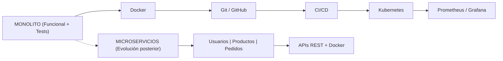

En esta primera etapa se completó y validó la totalidad de los requerimientos correspondientes a la arquitectura monolítica.
